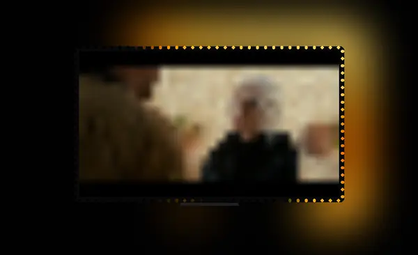
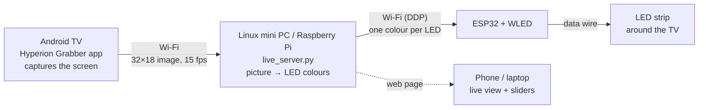
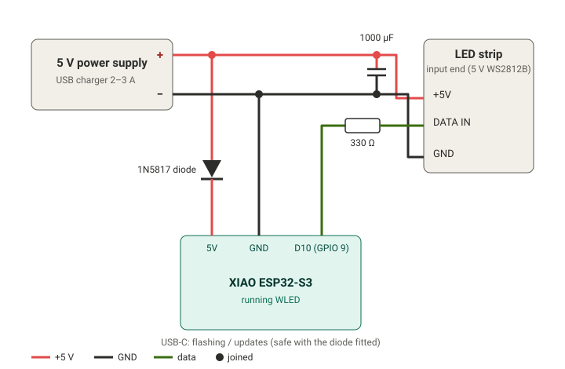

# TV Ambilight for Android TV

**Make an LED strip behind your TV glow with the colours on screen, like Philips Ambilight, for about $30 in parts.**

<p align="center">
  
  <br><sub>15 seconds of real data from the server: the picture the TV captured and the colour sent to each of the 108 LEDs.</sub>
</p>

The TV captures its own screen, a small always-on Linux computer turns that into one colour per LED, and a tiny ESP32 board running [WLED](https://kno.wled.ge) drives the strip over Wi-Fi. No HDMI splitter, no camera, no capture card.



## Features

- **Works with apps on the TV itself:** Stremio, YouTube, Plex, games. Anything without DRM protection (see [Limitations](#limitations)).
- **Black-bar removal:** letterboxed movies light the LEDs from the picture, not the black bars. Subtitles in the bars and dark scenes are handled.
- **Fast and smooth:** scene cuts and fades to black reach the LEDs on the next frame (~0.1 s); small flicker is smoothed out.
- **Live web page:** see the captured picture and every LED in real time. Tune saturation, contrast and smoothing with sliders; changes apply instantly. Login-protected.
- **Runs itself:** starts at boot, restarts the TV's grabber if the TV kills it, re-finds the TV if its IP address changes, keeps the LEDs lit on a paused screen.
- **Any LED layout:** set how many LEDs are on each side; a calibration tool finds the corners for you.

## What you need

| Part | Example | Approx. price |
|---|---|---|
| **ESP32 board** | Seeed **XIAO ESP32-S3** (used here) or any ESP32 / ESP32-C3 / S3 | $7–10 (¥1,200–1,600) |
| **Addressable LED strip, 5 V** | WS2812B / SK6812, 60 LEDs/m, enough to go round the TV (≈ 2 m for 49") | $10–15 (¥1,500–2,500) |
| **5 V power supply** | USB charger 2–3 A, or a 5 V 4 A adapter for brighter strips | $8–12 (¥1,000–1,800) |
| **Small parts** | 330 Ω resistor, 1000 µF capacitor, 1N5817 Schottky diode, wire, heat-shrink | $3 (¥400) |
| **Always-on Linux computer** | Any mini PC, old laptop or Raspberry Pi 4/5 you already have | $0 if you have one (Pi 5 ≈ $60) |
| **Android TV** | Android TV / Google TV with Developer options (Sony, TCL, Philips, Chromecast, Shield, …) | — you have it |
| **Total new parts** | | **≈ $30–40 (¥4,000–6,000)** |

> A ready-made "TV sync" LED kit (camera or USB type) is a cheap way to get a strip already cut to size. Just remove its controller and use the strip.

**Software (all free):** [WLED](https://install.wled.me) for the ESP32, [Hyperion Grabber](https://github.com/abrenoch/hyperion-android-grabber/releases) for the TV, and this project for the Linux box.

## Wiring



| From | To |
|---|---|
| Power supply **+5 V** (red) | Strip **+5 V** and ESP32 **5V / VUSB** (through the Schottky diode, stripe towards the ESP32) |
| Power supply **GND** (black) | Strip **GND** and ESP32 **GND**. The shared ground is required |
| ESP32 **D10 = GPIO 9** (XIAO ESP32-S3) | **330 Ω** → strip **DATA IN** |
| 1000 µF capacitor | Across strip +5 V / GND, near the strip |

Tips:
- Power the strip from the supply, **never** through the ESP32. WLED's power limiter keeps it within your supply's rating.
- The diode lets you plug in the ESP32's USB-C cable while the supply is connected. Without it, never connect both at once.
- Keep the data wire short (< 20 cm). Connect to the strip's **input end** (arrows on the strip point away from it).

## Setup

### 1. Install WLED on the ESP32
1. Plug the ESP32 into a computer by USB-C and open **https://install.wled.me** in Chrome or Edge, then click *Install*. (Or flash the matching `.bin` from the [WLED releases](https://github.com/wled/WLED/releases) with `esptool`.)
2. Connect your phone to the Wi-Fi network **WLED-AP** (password `wled1234`), open **http://4.3.2.1** and enter your home Wi-Fi. Alternatively, run `python3 tools/wled_wifi.py COM7 YourWiFiName` while it's on USB; it asks for the password.
3. In WLED → **Settings → LED Preferences**:
   - LED type **WS281x**, data **GPIO 9** (XIAO ESP32-S3 pin D10), length = **number of LEDs around the screen**
   - **Skip first LEDs**: the LEDs between the strip's start and the **top-left corner** of the screen
   - **Max current**: your supply's rating minus ~20% (e.g. 1500 mA for a 2 A charger)
4. Note WLED's address (shown in the WLED app, or `wled-xxxxxx.local`).

### 2. Prepare the Android TV
1. Enable **Developer options**: *Settings → Device Preferences → About*, then click **Build** 7 times.
2. In Developer options, turn on **USB debugging** and, if listed, **Network debugging / ADB over network**.
3. From the Linux box, connect once and accept the "Allow debugging?" prompt on the TV (tick *Always allow*):
   ```bash
   adb connect 192.168.1.50:5555
   ```
4. Install the grabber and open it once:
   ```bash
   wget https://github.com/abrenoch/hyperion-android-grabber/releases/download/v1.0/tv-release.apk
   adb install tv-release.apk
   ```
5. In the grabber: **Manual setup** → Host **your Linux box's IP** (give it a fixed address in your router), Port **19445**, Horizontal **32**, Vertical **18**, *Advanced → Capture rate* **15 fps** → **Save**. (Small on purpose: older TVs stutter when capturing more. If your video stutters, use 10 fps.)

### 3. Install the server on the Linux box
```bash
git clone https://github.com/AkshayKargaonkar/tv-ambilight.git
cd tv-ambilight
./install.sh                                   # installs adb + the always-on service
nano ambilight.env                             # TV address, WLED address, LED layout
python3 server/set_password.py you@example.com # login for the web page
sudo systemctl restart tv-ambilight
journalctl -u tv-ambilight -f                  # watch it connect
```
The server opens the ADB tunnel, starts the grabber on the TV (accepting the screen-capture prompt), and the strip lights up. Open **http://\<linux-box-ip\>:8765** for the live page.

### 4. Calibrate the LED layout
Everything maps clockwise from the **top-left corner**. To check your per-side counts:
```bash
python3 tools/corner_test.py wled-xxxxxx.local 33,21,33,21   # your top,right,bottom,left
```
Red should sit at the top-left corner, green at top-right, blue at bottom-right, yellow at bottom-left. If a marker is **N LEDs past** its corner, that side has N LEDs **fewer**; N LEDs **before** it, N **more**. If red is off, adjust *Skip first LEDs* in WLED. Put the final numbers in `LEDLIVE_LAYOUT`, then:
```bash
python3 tools/corner_test.py wled-xxxxxx.local --off
sudo systemctl restart tv-ambilight
```

## Tuning (on the web page)

| Control | What it does |
|---|---|
| **Saturation** | Colour strength. TV capture is often washed out; 1.8–3.0 looks vivid |
| **Contrast** | Higher = dark scenes darker, bright scenes brighter |
| **Smoothing** | 0 = instant, 1 = calm. Scene cuts always react immediately |
| **Ignore black bars** | Letterbox / pillarbox removal (green outline shows the picture area) |
| **Send to LED strip** | Pause output without stopping anything |

## How it works

1. **Capture:** the Hyperion Grabber app uses Android's screen capture to send a tiny 32×18 picture up to 15 times a second (only when the picture changes). It sends straight to the Linux box over Wi-Fi, which only accepts the TV's address. (Sending through an `adb reverse` tunnel, host `127.0.0.1`, also works, but adds about 40 ms per frame: the grabber writes each frame in two pieces, and the tunnel holds the second piece back.)
2. **Picture → LEDs:** black bars are detected and cropped; each LED averages its slice of the picture edge; colours are blurred slightly along the strip, smoothed over time (adaptively), then saturation / brightness / contrast are applied.
3. **Output:** each frame goes to WLED as one [DDP](http://www.3waylabs.com/ddp/) UDP packet (3 bytes per LED). On a still screen the last colours are re-sent every second so WLED stays in live mode.
4. **Watchdog:** every 10 s it checks the ADB link, the tunnel and the grabber, and restarts what dropped. Android TVs with little memory sometimes kill background apps.

## Troubleshooting

| Problem | Fix |
|---|---|
| Video stutters on the TV | Lower the grabber's capture rate / size (step 2.5). Free memory on the TV |
| LEDs black in Netflix, Prime, Disney+ | DRM: Android blocks capture of protected video. Not fixable in software |
| LEDs muddy / wrong colours on some TVs | Some MediaTek TVs return scrambled video frames; averaging recovers the colours. Raise Saturation |
| Page says "TV not reachable" | Check the TV is on and Network debugging is enabled. The server re-finds the TV if its IP changed |
| Colours on the wrong side | Run the corner test (step 4) |
| First LED flickers | Add/check the 330 Ω resistor; keep the data wire short; check the shared ground |
| Strip dims on bright scenes | That's WLED's power limiter. Use a bigger supply and raise *Max current* |

## Limitations

- Only works on **Android TV / Google TV** (screen capture + ADB). Samsung Tizen, LG webOS, Roku and Apple TV can't run the grabber.
- **DRM apps** (Netflix, Prime Video, Disney+) appear black to screen capture.
- Latency is roughly 0.1–0.3 s, fine for films and TV, not perfect for fast games.
- The TV's "Network debugging" must stay on. Some TVs turn it off after a reboot.

## Project layout

```
server/live_server.py    receiver + LED processing + WLED output + web page + watchdog
server/index.html        live page (picture, LEDs, sliders)
server/set_password.py   set the web page login (stored as a salted hash)
tools/corner_test.py     corner markers to calibrate the layout
tools/wled_wifi.py       give WLED your Wi-Fi details over USB (Improv)
install.sh               installs adb + the systemd service
ambilight.env.example    settings template
docs/wiring.svg          wiring diagram
```

## Credits

- [WLED](https://github.com/wled/WLED) for the LED firmware
- [Hyperion Android Grabber](https://github.com/abrenoch/hyperion-android-grabber) for screen capture on the TV
- [Hyperion / HyperHDR](https://github.com/awawa-dev/HyperHDR), the original ambient lighting projects that inspired this

## License

MIT, see [LICENSE](LICENSE).
